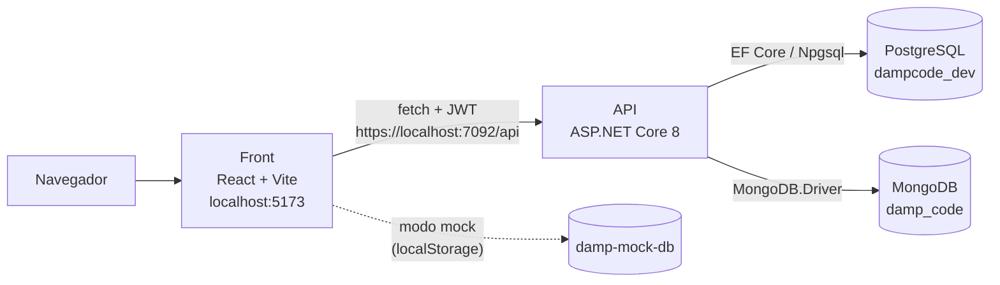
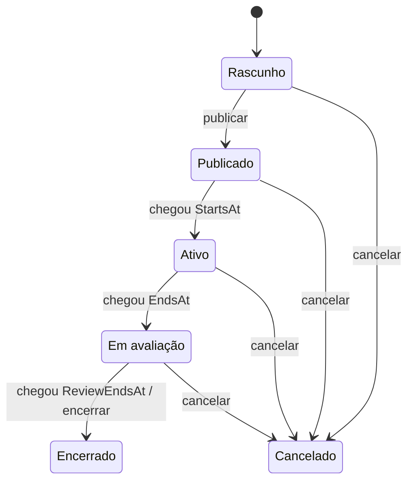

# 🧱 Arquitetura

Visão técnica da DampCode: como front, API e bancos conversam, onde fica cada coisa no código e quais rotas existem.

---

## 📖 Sumário
- [Visão geral](#-visão-geral)
- [Tecnologias](#-tecnologias)
- [Estrutura da API](#-estrutura-da-api)
- [Estrutura do front](#-estrutura-do-front)
- [Dados](#-dados)
- [Autenticação e papéis](#-autenticação-e-papéis)
- [Ciclo de vida do Hackathon](#-ciclo-de-vida-do-hackathon)
- [Rotas da API](#-rotas-da-api)
- [Páginas do front](#-páginas-do-front)

---

## 🔭 Visão geral



- O **front** é uma SPA (React Router com `BrowserRouter`). Guarda o usuário logado e o token no `localStorage` (chave `user`) e manda `Authorization: Bearer <token>` nas rotas protegidas.
- A **API** é REST, organizada em Controllers → Services → `DampCodeDbContext`. Regras de negócio ficam nos Services.
- O **PostgreSQL** guarda tudo que é estruturado (contas, empresas, Hackathons, equipes, inscrições, entregas, avaliações, módulos).
- O **MongoDB** guarda só o texto do código de cada versão de entrega; o PostgreSQL guarda a lista de versões e aponta para o documento no Mongo.

---

## 🧰 Tecnologias

### API (`DampCode_API`)

| Item | Versão |
|------|--------|
| ASP.NET Core | 8 (`net8.0`, `RollForward=Major`) |
| Entity Framework Core + Npgsql | 8.0.11 |
| MongoDB.Driver | 2.25 |
| Autenticação | JWT Bearer (`System.IdentityModel.Tokens.Jwt` 8.22) |
| Senhas | BCrypt.Net-Next 4.1 |
| Documentação | Swagger (Swashbuckle 6.6) |
| Testes | xUnit 2.9 + `Microsoft.AspNetCore.Mvc.Testing` 10 + EF Core InMemory (`net10.0`) |
| Ferramenta de migrations | `dotnet-ef` 8.0.11 (local, `dotnet-tools.json`) |

### Front (`Damp-Code-Front`)

| Item | Versão |
|------|--------|
| React | 19 |
| Vite | 8 (exige Node 20.19+ ou 22.12+) |
| React Router | 7 (`react-router-dom`, `BrowserRouter`) |
| Tailwind CSS | 4 (plugin `@tailwindcss/vite`) |
| Componentes | shadcn/ui + Radix (`src/components/ui`) |
| Gráficos | ApexCharts (`react-apexcharts`) |
| Animação | GSAP, Motion, Three.js (fundos) |
| Ícones | Font Awesome, Lucide, Tabler |
| PDF | jsPDF + jspdf-autotable |
| Lint | ESLint 9 |

Atalho de importação: `@/` aponta para `src/` (`vite.config.js` e `jsconfig.json`).

---

## 📂 Estrutura da API

```
DampCode_API/
├── DampCode_API.slnx
├── dotnet-tools.json              # dotnet-ef fixado
├── docs/superpowers/
│   ├── specs/                     # design de cada funcionalidade
│   └── plans/                     # plano de implementação
├── DampCode_API/
│   ├── Program.cs                 # DI, CORS, Swagger, autenticação
│   ├── appsettings.json           # Jwt:Issuer/Audience, Mongo (sem segredos)
│   ├── Properties/launchSettings.json   # perfis http / https
│   ├── Authentication/            # JWT, papéis, validação do token contra a conta
│   ├── Controllers/               # Auth, Companies, Hackathons, Participations, Teams, Users
│   ├── Services/                  # regras de negócio (interface + implementação)
│   ├── Models/                    # entidades
│   ├── Dto/                       # entrada e saída das rotas
│   └── Data/
│       ├── DampCodeDbContext.cs
│       ├── Configurations/        # mapeamento EF (tabelas snake_case, índices, constraints)
│       ├── Migrations/
│       ├── MongoDbService.cs
│       └── MongoSubmissionVersionStore.cs
└── DampCode_API.Tests/            # testes de serviço e de endpoint
```

---

## 📂 Estrutura do front

```
Damp-Code-Front/
├── .env.development               # VITE_USE_MOCK=true
├── index.html
├── vite.config.js
├── public/favicon.svg
└── src/
    ├── main.jsx                   # providers, BrowserRouter, instala o mock
    ├── App.jsx                    # todas as rotas
    ├── style.css / index.css      # Tailwind e tema
    ├── Pages/                     # uma página por rota
    │   ├── admin/                 # verificação de empresas
    │   ├── company/               # painel, criação, entregas, avaliação, módulos, gráficos
    │   └── participant/           # painel e perfil
    ├── app-components/            # componentes por área (home, hackathon-page, charts, auth...)
    │   └── utilities/             # AuthContext, RequireRole, RequireGuest, helpers
    ├── components/ui/             # componentes shadcn
    ├── mock/                      # installMockApi.js + seed.js
    ├── data/
    ├── lib/utils.js
    └── assets/
```

---

## 💾 Dados

### PostgreSQL

| Tabela | Conteúdo |
|--------|----------|
| `accounts` | login de qualquer tipo de conta (e-mail, hash da senha, tipo, status, avatar) |
| `user_profiles` / `user_technologies` | perfil do participante e suas tecnologias |
| `companies` / `company_technologies` | empresa, CNPJ, área, status de verificação |
| `company_memberships` / `company_invitations` | funcionários da empresa e convites |
| `technologies` | catálogo de tecnologias |
| `hackathons` / `hackathon_technologies` | Hackathon, datas, status, cores, logo, solução de referência |
| `hackathon_prizes` | prêmios por posição |
| `hackathon_teams` / `team_invitations` / `team_join_requests` | equipes, convites e pedidos para entrar |
| `participations` | inscrição de um participante num Hackathon (sozinho ou em equipe) |
| `submissions` / `submission_versions` | entrega (com nota, comentário e posição final) e lista de versões |
| `hackathon_modules` / `hackathon_module_contents` | módulos de estudo e conteúdos (Texto, Link, Vídeo) |
| `__EFMigrationsHistory` | controle das migrations aplicadas |

### MongoDB

| Banco | Coleção | Documento |
|-------|---------|-----------|
| `damp_code` | `SubmissionVersions` | `{ _id, submissionId, code, createdAt }` |

---

## 🔑 Autenticação e papéis

1. Cadastro (`POST /api/Auth/register/participante` ou `/register/empresa`) ou login (`POST /api/Auth/login`) devolvem um **JWT**.
2. O token é assinado com `Jwt:Secret`, emitido por `Api` para `Front` e vale 24h (`Jwt:ExpirationMinutes`).
3. O papel vai na claim `role`: `participante`, `empresa` ou `admin`.
4. A cada requisição, o `AccountTokenValidator` confere se a conta ainda existe, está ativa e não trocou as credenciais depois de o token ser emitido.
5. No front, `RequireRole` protege as páginas por papel e `RequireGuest` esconde login/cadastro de quem já entrou.

---

## ⏳ Ciclo de vida do Hackathon

O status gravado manda em rascunho, cancelado e encerrado manualmente; depois de publicado, **as datas decidem a fase** (sem job em segundo plano):



- Regra das fases em `DampCode_API/Models/HackathonPhase.cs` (`HackathonPhases.GetPhase`); ações em `Services/HackathonService.cs`.
- **Publicar** exige empresa verificada pelo Admin, campos obrigatórios preenchidos, início no futuro e datas em ordem (início < fim < fim da avaliação).
- **Encerrar** à mão só durante a avaliação. **Apagar** só rascunho; depois disso, cancelar.

---

## 🌐 Rotas da API

Lista completa e testável no Swagger (`https://localhost:7092/swagger`). Resumo:

| Grupo | Rotas principais | Quem usa |
|-------|------------------|----------|
| `api/Auth` | `register/participante`, `register/empresa`, `login`, `GET/PUT me`, `PUT me/senha` | todos |
| `api/Companies` | `me`, `me/employees`, `me/invitations`, `invitations/received`, `invitations/{id}/accept\|decline` | empresa e funcionários |
| `api/Companies` (Admin) | `GET pending-verification`, `PATCH {id}/verification` | admin |
| `api/Hackathons` | `GET` (público), `GET {id}` (público), `GET empresa`, `POST register/Hackathon`, `PUT/DELETE {id}`, `POST {id}/publicar\|cancelar\|encerrar` | empresa / público |
| `api/Hackathons/{id}` — inscrição e equipes | `POST/DELETE inscricao`, `GET/POST equipes` | participante |
| `api/Hackathons/{id}` — entregas | `GET/POST entrega`, `entrega/versoes/{versao}`, `entregas`, `entregas/{submissionId}`, `referencia` | participante / empresa |
| `api/Hackathons/{id}` — avaliação | `GET avaliacao`, `PUT entregas/{submissionId}/avaliacao`, `PUT vencedores`, `GET resultado` (público), `POST resultado` | empresa / público |
| `api/Hackathons/{id}` — módulos | `GET modulos` (público), `POST modulos`, `PUT modulos/ordem`, `PUT/DELETE modulos/{moduloId}`, conteúdos dentro de cada módulo | empresa / público |
| `api/Teams` | `PATCH {teamId}`, convites (`convites/...`), pedidos (`pedidos/...`), `DELETE {teamId}/membros/me` | participante |
| `api/Participations` | `GET me` | participante |
| `api/Users` | `GET`, `GET {id}` | autenticado |

---

## 🧭 Páginas do front

| Rota | Página | Acesso |
|------|--------|--------|
| `/` | Home | público |
| `/explore` | Explorar Hackathons | público |
| `/hackathon/:id` | Página do Hackathon | público |
| `/ranking` | Resultados dos Hackathons | público |
| `/sobre`, `/termos`, `/privacidade` | Institucionais | público |
| `/escolha` | Escolha do tipo de conta | só quem não entrou |
| `/loginUser` | Login | só quem não entrou |
| `/cadastroUser` | Cadastro de participante | só quem não entrou |
| `/cadastroEmpresa`, `/cadastroEmpresa/detalhes` | Cadastro de empresa | só quem não entrou |
| `/dashboard/participante` | Painel do participante | participante |
| `/perfil` | Perfil e configurações | participante |
| `/hackathon/:id/entrega` | Entrega de código | participante |
| `/dashboard/Empresa` | Painel da empresa | empresa |
| `/cadastroHackaton`, `/cadastroHackaton/:id` | Criar / editar Hackathon | empresa |
| `/cadastroHackaton/:id/modulos` | Módulos e conteúdos | empresa |
| `/dashboard/Empresa/entregas/:id` | Entregas recebidas | empresa |
| `/dashboard/Empresa/avaliacao/:id` | Avaliação e vencedores | empresa |
| `/dashboard/ranking` | Gráficos da empresa | empresa |
| `/conta` | Configurações da conta | qualquer conta logada |
| `/admin` | Verificação de empresas | admin |
| `*` | Página 404 | público |
